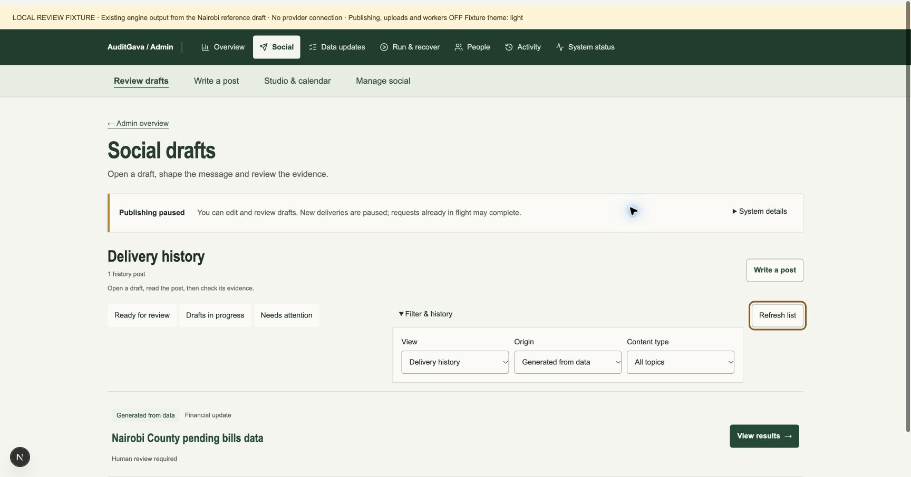
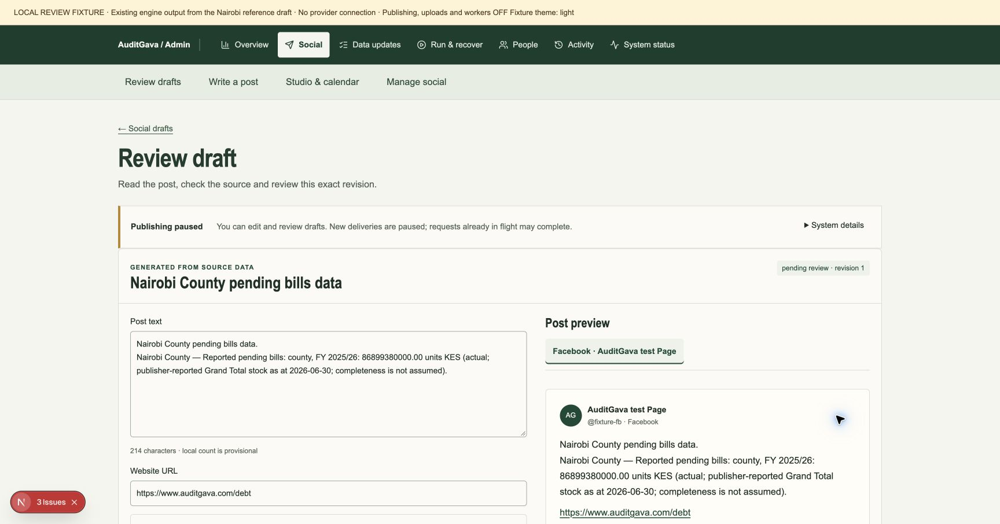
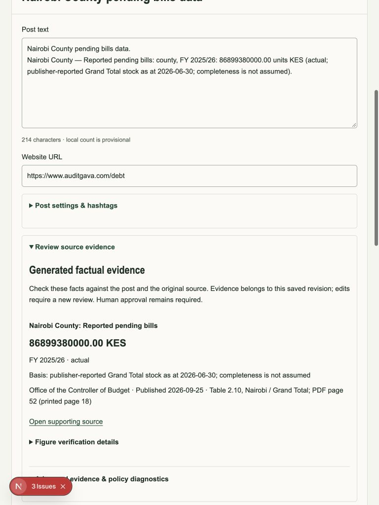
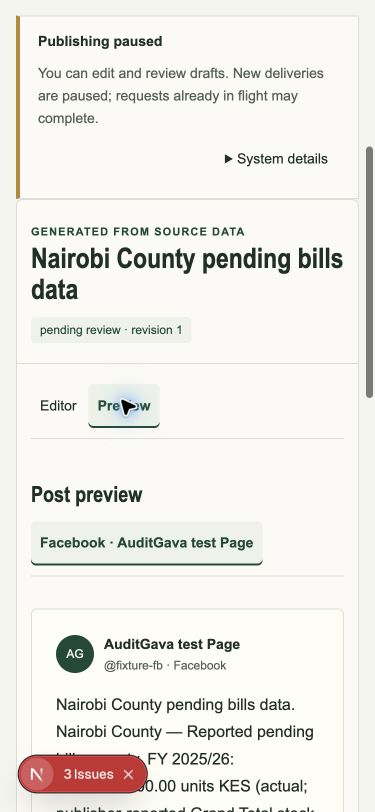

# First increment validation

This increment covers private admin headers/navigation and the social queue, full draft review and composer. Backend timeout #849, shared renderer copy, remaining admin inner flows and production acceptance remain open.

The queue opens a full review page and retains its view, page, origin and topic in a constrained URL. Optional composer settings and evidence diagnostics use native disclosures. Validation errors reveal the affected control, preserve destination identity, select its account/panel and offer a focused correction link. Existing approval, authorization, immutable revision, idempotency, unsaved-edit and session boundaries remain covered.

## Local results

- Full frontend Jest: **198 suites passed; 2,690 tests passed, one skipped**. The skipped test is pre-existing. Receipt: `full-frontend-candidate5-tools.txt`.
- TypeScript `--noEmit --incremental false`: passed. Receipt: `types-candidate5.txt`.
- Scoped Next lint: passed after supplying the required inert public URL configuration. Receipts: `lint-final.txt`, `lint-candidate5-env.txt`.
- Production Next build: candidate5 and final CSS-only candidate6 passed. Receipts: `build-candidate5.txt`, `build-candidate6.txt`.
- Independent Spec: 39 executable cases passed on candidate5. Candidate6 verified as one CSS declaration only, with all 5,679 source hashes matching.
- Independent Standards: 66 executable cases passed on candidate5. Candidate6 has the same behavior source; actual compiled CSS/Chrome checks confirm light/dark canvas, primary hover and keyboard focus. These are carried-forward behavior results, not a claim of another 66-case execution on candidate6.
- Root Chrome: 375×812 phone editor/preview/evidence, 768×1024 tablet, normal 1728×906 desktop; no horizontal page overflow in measured views. History/origin survive opening a draft, browser Back, back link and reload. Keyboard focus reaches the source link. Temporary viewport overrides were reset.

Final reviewed source manifest: `review-manifest-6.json`, SHA-256 `17d70f12e14963f9e43e364638d6ce86350422afa6d1fe4d276d236ed9c70627`. Reports: `spec-review-r5/REPORT.md`, `spec-review-r6/REPORT.md`, `standards-review/FINAL.md` in the local evidence directory.

## Reproduction environment and limits

Execution used owned Docker containers with `--network none`, two CPUs, 3 GiB memory and 256 PIDs, Node 24.22.1 and the committed Linux dependency lock (Next 15.5.28). Host use was limited to file/Git/CLI operations and a Python standard-library loopback byte bridge to the offline browser fixture. No app execution or package installation ran on the host. The Git-dependent frozen-paint test reads the repository Git metadata through a read-only mount; the primary dirty checkout was not changed.

An initial full-suite attempt used a container without Git and failed the frozen-paint preparation test. A subsequent lint attempt omitted required public URL configuration. Those setup failures are retained and were corrected without weakening tests. Offline production builds may log public data fetch failures against the inert loopback address; successful compilation does not certify a live API.

`frontend/browser-fixtures/admin-redesign/serve.mjs` builds a separate local Next harness from actual components/routes. Its explicit inert API contains an earlier Nairobi engine draft and source reference; it does not acquire source data, call providers, approve, publish, upload, reconnect or change controls. Unknown paths refuse; the intentionally unavailable media-capability route produces a development notice. The screenshots retain this fixture notice. They demonstrate the UI with existing engine copy, not improved renderer output or a production draft.

The local evidence directory is `/Users/roger/.codex/visualizations/2026/10/29/01a1886d-f9ce-70c1-8bdf-14a2bb51c304/admin-redesign`. Failing controls, corrected preparation attempts, earlier manifests and screenshots are retained there. The source-bound fixture and committed regression tests are available in the branch.

## Review images

All images show an inert local fixture with publishing, uploads and workers off.

## Admission holds

Normal CI and Docker deployment workflows remain disabled manually. Preview environment Branch Tracking was read in Vercel and confirmed off before pushing. The separately admitted nightly ingestion workflow was left unchanged. Draft PR only: no bot review, hosted run, source backfill, merge, deployment, worker start or production control change is included.
