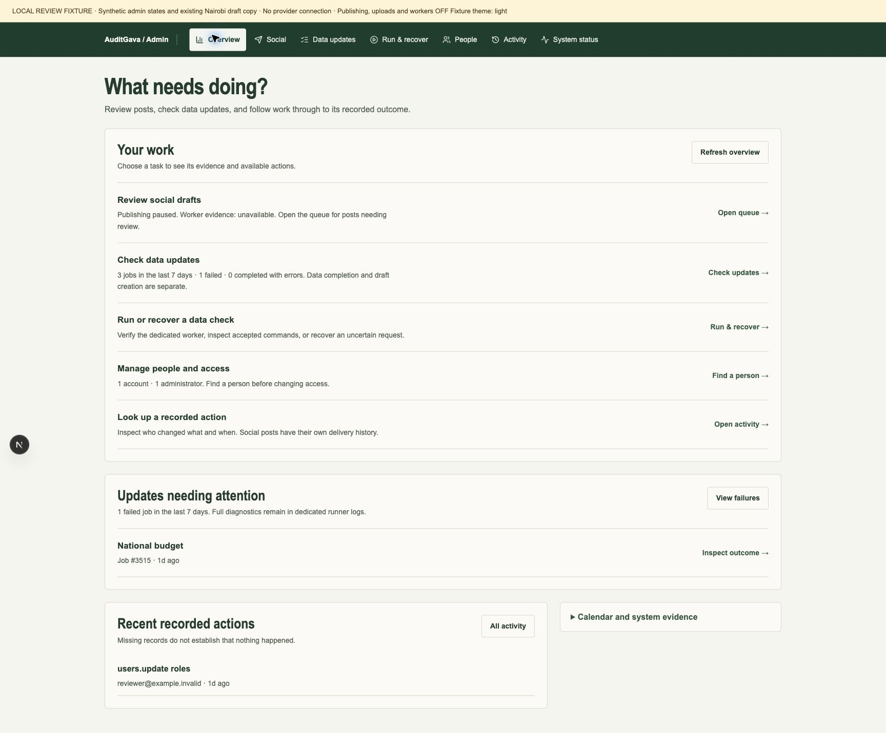
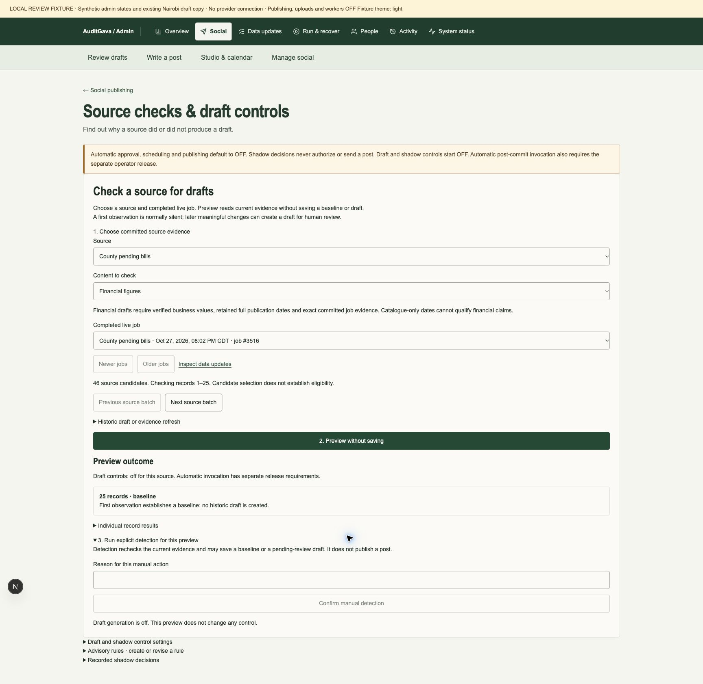
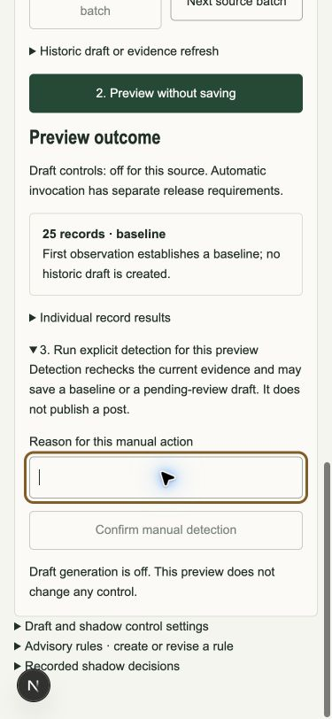
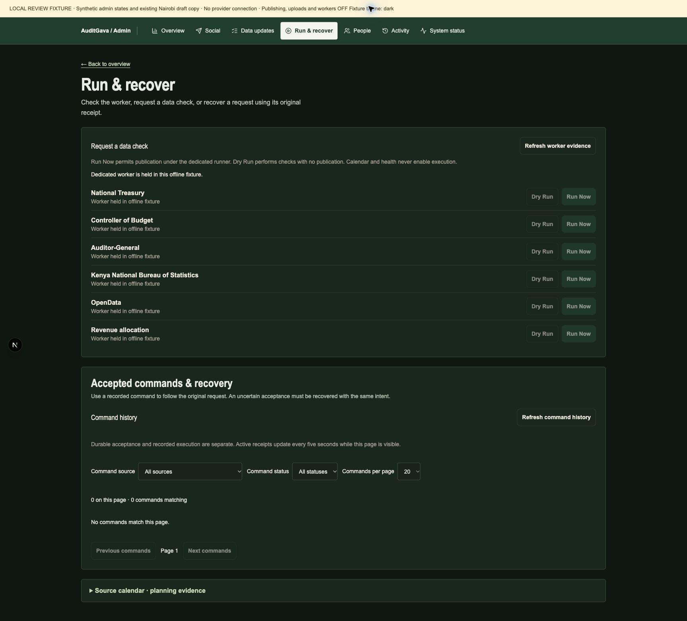

# Admin task workflows

This increment continues draft PR #850 from commit `01f663a28396c7e67e08959dec8b3b59d95c60c2`. It applies the same private admin design and task map to the inner operational workflows. The shared deterministic renderer and cohort timeout repair are separate drafts; this change does not activate them or alter ingestion admission.

| Task | Operator flow |
| --- | --- |
| Overview | Choose review drafts, check data updates, run/recover, people, or activity. Each available count keeps its stated scope; failed jobs and unavailable calendar calculations have actionable notices. |
| Data updates | Select a named source, outcome and time window. Read a responsive job row; inspect data counts separately from draft and source-retention outcomes. Return preserves canonical list filters. |
| Source checks | Choose a source and content type, select a completed live job, then preview a bounded source batch. Identical results are summarized; individual references are disclosed. Reasoned manual detection and historic backfill remain explicit. |
| Run & recover | Verify dedicated worker capability; follow accepted commands and recover uncertain intent. Command receipts give the next inspection step. Calendar planning is contextual evidence. |
| People | Search by email, review account identity and roles, then disclose password recovery or removal. Existing typed mutation and deletion-confirmation behavior remains. |
| Activity | Use action/time filters first and disclose technical actor/target filters. Snapshot pagination and redaction remain intact. |
| System status | Read observed issues and homepage checks; use worker/command evidence for execution. Inventory and retired web-seeder diagnostics are contextual. |
| Studio | Choose create media, review renders, or calendar. A common source picker supports creation and matching an inspected derivative. Exact checksum, source revision, fact review, and media intake remain required. |
| Social management | Connected identities precede new Meta connection setup; other platforms, provider analytics and privacy proposals have focused disclosures. Media has readable dark-mode states. |

## Source navigation contract

The new admin-only `GET /admin/social/generation/source-records` resolves exact committed lineage through the existing reviewed source readers. It returns at most 25 IDs per page from a cohort capped at 1,000, with bound source, job, content kind, page and total. Existing readers apply their reviewed successful-live-job and exact-lineage guards in bounded read-only snapshots. Selection refuses overflow; preview and detection own full current-evidence qualification. The endpoint introduces no source acquisition, grants, audit/command receipt, baseline, event, draft or publication.

The list contains candidates, not a qualification receipt. Preview re-reads current evidence; manual detection rechecks it again under the existing command and source-authority gates. Native report Extraction IDs stay separate from financial row IDs. The normal UI asks for a source and job, with no pasted record IDs. Historic backfill is a disclosed manual action and cannot be presented as proof of unattended generation.

## State and control boundaries

Actor transitions retire local source selection, preview and command results. Studio and privacy queries use the shared actor position in private admin cache keys, consume read cancellation signals, and retire late local results. Late Studio preview/transcript blobs are revoked. Privacy decisions and execution require fresh matching request, policy and capability evidence; retained plans cannot enable controls while the workflow is closed or a refresh is unresolved.

Publishing, uploads, native/social/supervisor workers, ordinary admin consumer and automatic financial admission remain held. Existing worker dispatch, idempotency recovery, independent privacy approval, source qualification and publication gates remain authoritative. No production mutations, deployment, merge, paid service, hosted review or activation is included.

## Local review views

These are Chrome captures of actual components using the closed offline browser fixture. They are synthetic admin states, not production or source-qualification receipts. The source/worker screenshots precede the final actor-only and control-admission repairs; their visible layout is unchanged. The fixture intentionally refuses unknown reads and all operational writes, so its accumulated API/Next development issues are not a clean-console acceptance claim.

