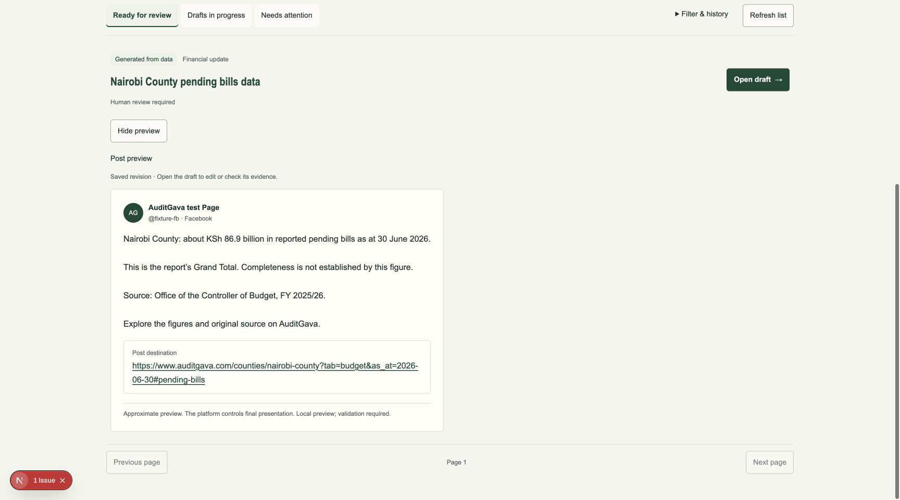
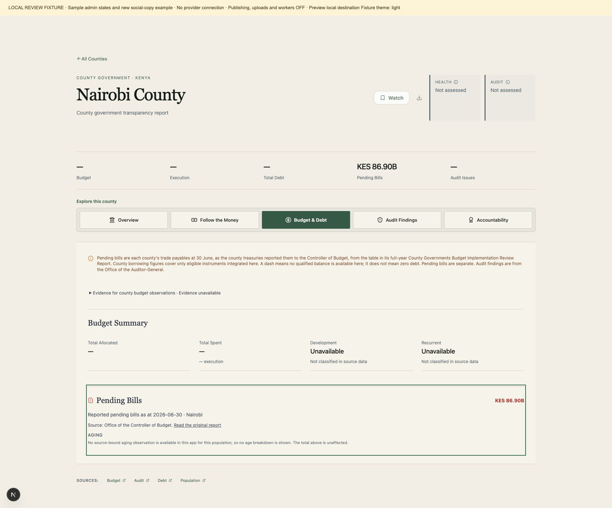

# Social draft review follow-up

The queue now offers **Preview post** without opening the editor. It loads the actual saved document on demand, resolves account overrides, displays the destination URL and identifies the preview as approximate. It does not validate or publish anything. Actor changes reset the open preview; mismatched revisions are withheld with a refresh action. Read failures have a retry action.

County pending-bills destinations select the Budget & Debt tab, the `#pending-bills` section and the stated `as_at` reporting day. The public reader selects that exact day, including source metadata from those selected rows. Its cache distinguishes dates. Missing historical data stays absent; loading, invalid dates and errors never substitute the comprehensive page’s latest pending-bills value. The lazy section scrolls into view and receives focus after mounting.

Compact financial-v3 copy is implemented separately in draft PR #852. For example, the unchanged exact evidence value `86899380000.00 KES` is displayed as **about KSh 86.9 billion**. Existing saved copy versions remain reproducible. Deploy this date-aware public reader/UI before admitting new v3 county links in production. Both PRs remain drafts and all production activation holds remain in place.

The loopback review fixture uses actual admin and public county components with inert APIs. Its example text was exported from the actual financial-v3 renderer. The banner labels sample states. The local-destination shortcut exercises the local public component; the post’s canonical URL remains the eventual production destination. It does not connect to provider accounts, production data or workers.

Author verification and the independent Spec/Standards follow-up results are retained in the task evidence folder under `social-enhancements-*`. Browser receipts include desktop/phone previews, phone dark mode and the county landing. They are UI fixture checks, not production acceptance or a full platform/WCAG certification.

Final author checks: 204 frontend suites, 2,761 passing tests and one existing skip; production build/type checking and lint pass. The 32 public-reader HTTP/source tests pass. The financial stack separately passes 104 normal checks, 59 optimized focused checks and the 46-county installed-witness cohort rehearsal.

Final frozen product manifests: UI3 `516729a9ae0015399a9859fa1b4d96e9e84939f0bde6eabdb51b248fcd333c64` (2,230 files); backend1 `6c04ac2b775f585f210bd161ba80f3c891d1e7a180c386b7f4bd792c560374ff` (1,422 files). Staged product bytes match these manifests.

Independent final review: Spec passes 139 numeric/accepted-replay cases, 34 UI cases and four HTTP controls, plus 59 backend and 32 public-reader repository replays. Standards passes 173 backend and 36 UI cases, including a real writer → saved draft/link → public HTTP → adapter/hook/component replay with structured caveats. All three reproduced consumer findings are fixed. Reports: `social-enhancements-spec-review/REPORT.md` and `social-enhancements-standards-review/REPORT.md` in the task evidence folder. These exercise the cross-stack seam without claiming a built merged checkout, production/source acceptance, provider presentation or full WCAG conformance.
