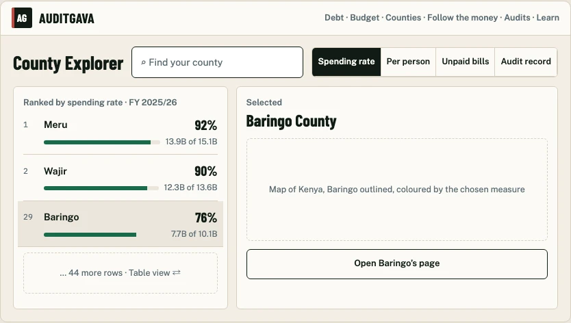
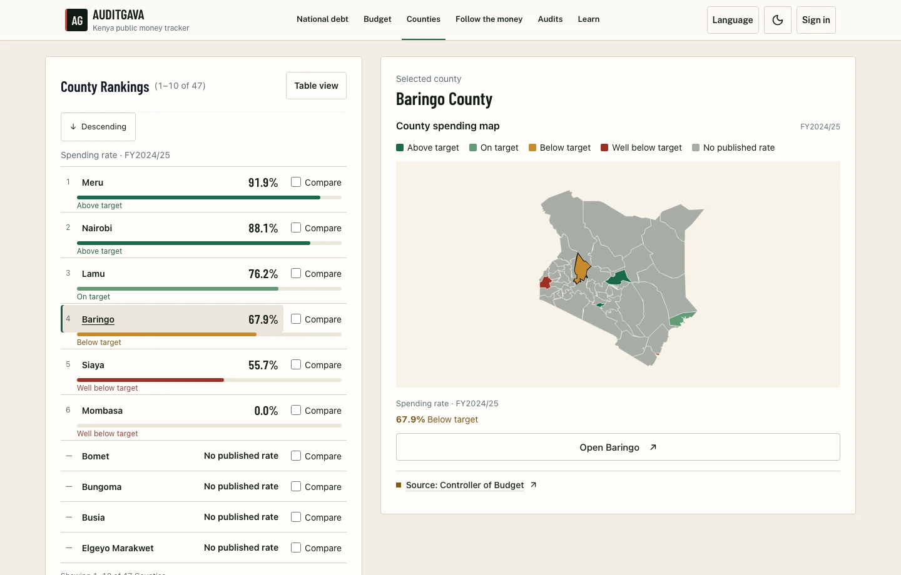

# County Explorer desktop layout

The approved [County Explorer blueprint](../../../ui-ux-audit-2026-11/index.html#b-counties) places the ranked list left of the selected county and map. The layout changes at the existing 960 px rankings breakpoint.

| Approved desktop | Implemented desktop at 1440 px |
| --- | --- |
|  |  |

- [Desktop at 1024 px](desktop-split-light-1024.webp), [1280 px](desktop-split-light-1280.webp), [dark mode](desktop-split-dark-1440.webp), and [optional table with sticky headers and source controls](desktop-table-light-1440.webp).
- [List at 360 px](compact-list-360.webp) and [768 px](compact-list-768.webp), and [touch map summary at 360 px](compact-map-sheet-360.webp).

The browser screenshots use locally generated data and source receipts. Verification covered 360, 390, 430, 768, 1024, 1280 and 1440 px with no document overflow. It also covered keyboard selection, 44 px targets for the new controls, the source dialog, the original touch summary and focus return, reduced motion, and light and dark modes. Scoped axe checks reported zero WCAG 2.1 A/AA violations in the compact list, desktop workspace and table.
